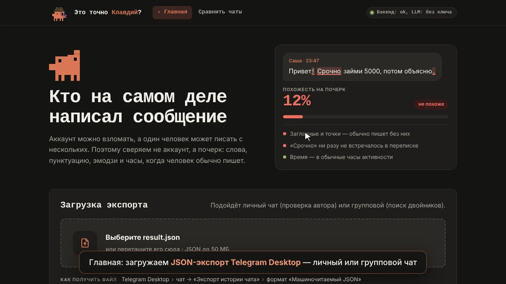
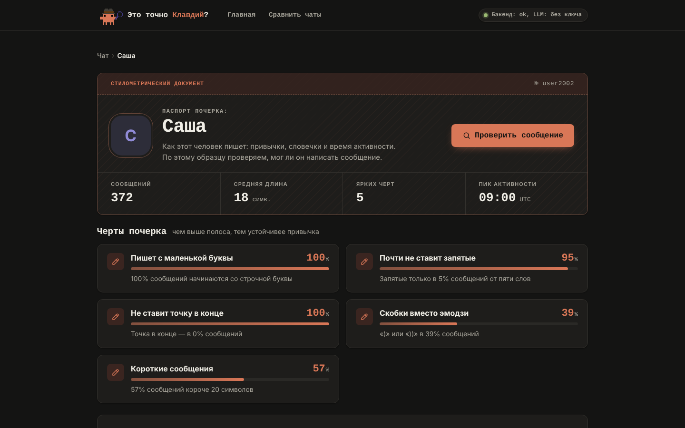
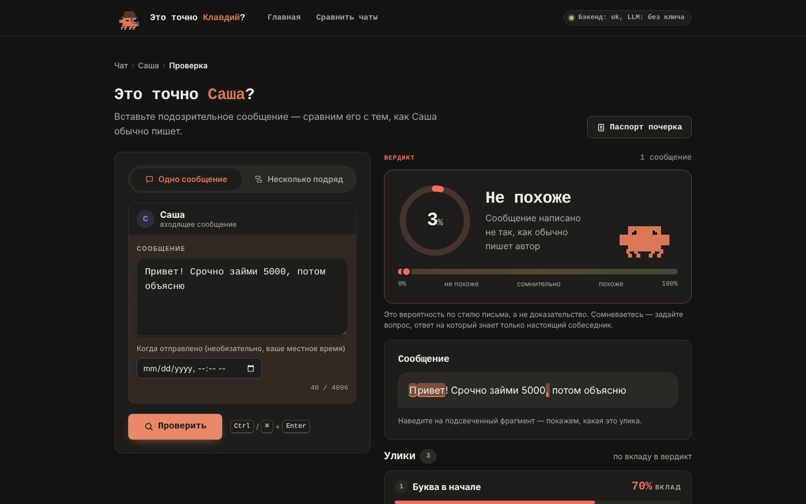
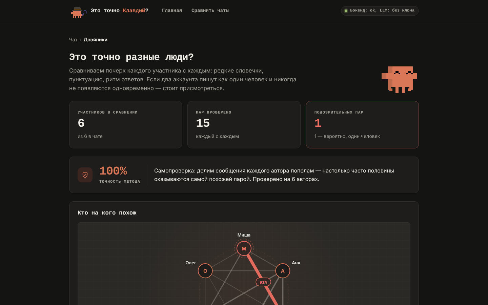
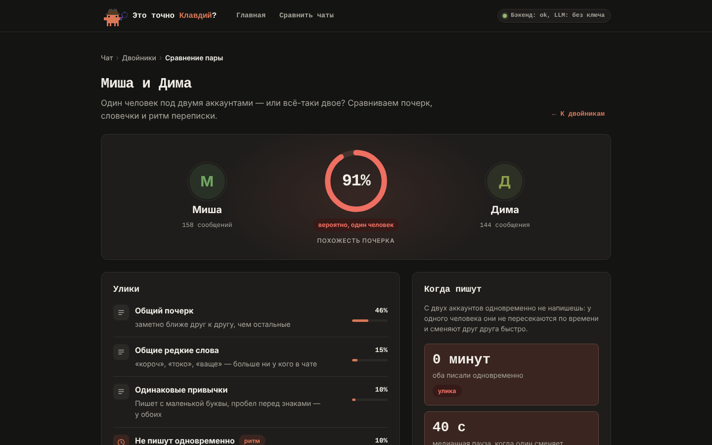

# «Это точно Клавдий?» — *Is that really Claudius?*

[](https://github.com/IvanIkra/chat-handwriting/actions/workflows/ci.yml)
[](LICENSE)

Authorship forensics for Telegram chats: check who really wrote a message by their **writing style**, not by the account it came from.

Hackathon theme: **"The internet is no longer proof."**

A messenger message no longer proves who wrote it. Accounts get hijacked, and a "friend" writes "Hi! Urgently lend me 5000". One person runs several accounts and agrees with themselves. We check the author not by the account but by their **handwriting**: how they write, which words and punctuation they use, and when they are usually online.

The service works with Telegram Desktop JSON exports. A verdict is always a probability backed by evidence, never a sentence.

> The UI and the stylometric features are tuned for Russian-language chats.

## Demo

[](docs/media/demo.mp4)

▶ [Watch the demo video](docs/media/demo.mp4) (3:39, every mode on the files from [`demo/`](demo/README.md), no LLM key) · 📄 [Pitch deck (PDF, in Russian)](docs/pitch.pdf)

| Handwriting passport | Message check |
|---|---|
|  |  |
| **Twins in a group chat** | **Twin pair in detail** |
|  |  |

## Use cases

- **Business: detect second accounts.** One person behind several profiles: fake reviews and discussions, ban evasion, multi-accounting. Handwriting and activity hours show that "different" users are the same person.
- **Free-trial abuse.** Someone who registers a new account for yet another free period writes to support and in chats with the same handwriting as before.
- **Security teams and public agencies:** find people hiding behind second accounts and link anonymous profiles to known ones.
- **Everyday users:** a "friend" on a hijacked account asks to "urgently lend" money, or an acquaintance's new account turns out not to be them.

**Next:** a behavioral fingerprint. On top of text and chats, add behavior on a web page or in an app: typing rhythm, movements, pauses, activity hours. Together they form one profile of a person that does not change with the account.

## Features

| Mode | Question | What you see |
|---|---|---|
| **Handwriting passport** | How does this person write? | 5–10 traits ("starts with a lowercase letter — 100%", "brackets instead of emoji"), activity hours, favorite words and emoji |
| **Check** | Is this message really from Sasha? | A 0–1 score and a verdict, with mismatches highlighted right in the text. Check a single message or a series in a row. When in doubt, a challenge question from your shared history |
| **Twins** | Are these really different people in the group? | A graph of participants, "most likely the same person" pairs with evidence, and both accounts' messages side by side |
| **Two chats** | Are Sasha and Alex the same person? | Every author of one chat against every author of the other. Shared participants (usually you) are excluded |

## How it works

Classic stylometry with scikit-learn, no neural network training:

- **Handwriting:** character n-grams, punctuation, capitalization, brackets and emoji, message length, characteristic and rare words.
- **Time:** activity hours. Twins never write at the same time and switch within tens of seconds.
- **Evidence:** each signal is a place where the text goes against the author's habits. Its strength is how many times more likely this is for an average person than for this author.
- **Self-check:** each author's messages are split in half, and we check whether the halves find each other. This is our honest accuracy number.
- **LLM (Claude API), optional:** a plain-language explanation of the evidence and a challenge question from the chat history. Everything works without a key, just without these texts.

Data is kept only in the backend's memory until restart.

## Results on demo data

Synthetic chats from [`demo/`](demo/README.md), without an LLM:

- **Fakes** from "hijacked" Sasha: 8 of 8 get "mismatch" (0.00–0.17).
- **Real** messages from Sasha: none gets "mismatch". The best three score 0.61–0.70.
- **Twins:** Dima and Misha in the group chat are "most likely the same person", 0.91. The next pair scores 0.33.
- **Two chats:** Sasha and Alex are "most likely the same person", 0.89.
- **Self-check:** 6 of 6 group members found themselves.

## Quick start

Requirements: Python 3.12+ and Node.js 20.19+ or 22.12+. Run each command from the repository root.

```bash
cd backend && python3 -m venv .venv && .venv/bin/pip install -r requirements.txt
```

```bash
cd frontend && npm install
```

Backend (port 8000):

```bash
cd backend && .venv/bin/uvicorn app.main:app --reload --port 8000
```

Frontend (port 5173, proxies `/api` to the backend):

```bash
cd frontend && npm run dev
```

Open http://localhost:5173 and upload `demo/personal_main.json`. Messages to check are in `demo/checks.txt`.

- **Without the backend:** `cd frontend && npm run dev:mock` runs the frontend on mocks from the API contract.
- **With the LLM:** `cp .env.example .env` and set `ANTHROPIC_API_KEY`.
- **Without the LLM while `.env` has a key:** start the backend with an empty key: `ANTHROPIC_API_KEY= .venv/bin/uvicorn …`. `env -u` will not help: the key is still loaded from `.env`.

## Tests and lint

```bash
cd backend && .venv/bin/pytest && .venv/bin/ruff check . && .venv/bin/ruff format --check .
```

```bash
cd frontend && npm test && npm run lint && npm run build
```

CI runs the same checks on every pull request.

## Project layout

| Path | Contents |
|---|---|
| `backend/` | FastAPI: export parsing, handwriting features, check, twins, comparison, LLM |
| `frontend/` | React + TypeScript + Vite |
| `demo/` | synthetic chats and messages to check, see [`demo/README.md`](demo/README.md) |
| `docs/IDEA.md` | [idea, MVP and demo script](docs/IDEA.md) |
| `docs/CONTRACT.md` | [API between frontend and backend](docs/CONTRACT.md), the source of truth |
| `docs/PROCESS.md` | [how the team works](docs/PROCESS.md): zones, git, Claude Code commands |
| `docs/media/` | demo video and screenshots |
| `docs/pitch.pdf` | pitch deck (in Russian) |
| `scripts/` | one-time GitHub repository setup |

Put real exports in `data/`: the folder is in `.gitignore` and never committed.

## Team

| Zone | Who |
|---|---|
| Backend | [@IvanIkra](https://github.com/IvanIkra) |
| Frontend | [@s1ngul0r](https://github.com/s1ngul0r) |

## License

[MIT](LICENSE)
